# Vault Map & Structural Architecture
## Visual Map, Directory Layout & File Organization

---

## 1. Visual Topology (Mermaid Diagram)

```mermaid
graph TD
    ROOT[NY17-52 Vault Root]
    
    ROOT --> WELCOME[welcome.md<br>Central Hub]
    ROOT --> HOW2USE[how2use.md<br>User Manual]
    ROOT --> README[README.md<br>Overview]
    ROOT --> AGENTS[AGENTS.md<br>Operating Rules]
    
    ROOT --> RAW[raw/<br>Layer A: Immutable Evidence]
    RAW --> RAW_DOCS[documents/]
    RAW --> RAW_RES[research/]
    RAW --> RAW_CLIPS[web-clips/]
    
    ROOT --> WIKI[wiki/<br>Layer B: Knowledge Wiki]
    WIKI --> SOURCES[sources/<br>SRC-001 to SRC-005]
    WIKI --> CONCEPTS[concepts/<br>17 Core Concepts]
    WIKI --> ENTITIES[entities/<br>NYS DFS, Superintendent, Guaranty Corp]
    WIKI --> COMPARISONS[comparisons/<br>Term/Whole/UL, Medicare/Medicaid]
    WIKI --> SYNTHESES[syntheses/<br>Master Cram Sheets & Guides]
    WIKI --> QUESTIONS[questions/<br>Exam Question Bank & Traps]
    WIKI --> INDEX[index.md & log.md<br>Catalog & Audit Trail]
    
    ROOT --> LEARN[Learning/<br>Socratic University]
    LEARN --> DASH[Learning Dashboard.md]
    LEARN --> CURR[Curriculum.md]
    LEARN --> PROG[Learning Progress.md]
    LEARN --> GAPS[Knowledge Gaps.md]
    LEARN --> QUEUE[Review Queue.md]
    LEARN --> LESSONS[Lessons/<br>Interactive Lessons]
    
    ROOT --> TEMP[templates/<br>Layer C: 6 Note Blueprints]
    ROOT --> SCRIPTS[scripts/<br>wiki_lint.py Automation]
    ROOT --> DOCS[docs/<br>Reference Manuals]
```

---

## 2. Directory Hierarchy & Role Reference

| Path | Architectural Layer | Primary Function |
| :--- | :--- | :--- |
| **`welcome.md`** | Hub | Primary landing page and navigation portal |
| **`how2use.md`** | Manual | Comprehensive user manual, workflows, and tools |
| **`README.md`** | Overview | Vault introduction and examination summary |
| **`AGENTS.md`** | Schema | Universal LLM Wiki operating rules & 8-step pipeline |
| **`raw/`** | **Layer A** | Read-only storage for original PDFs and official bulletins |
| **`wiki/`** | **Layer B** | Derived knowledge layer (concepts, entities, syntheses, questions) |
| **`wiki/index.md`** | Layer B | Master catalog indexing all 38 wiki notes |
| **`wiki/log.md`** | Layer B | Chronological audit trail of all ingestion operations |
| **`Learning/`** | Education | Socratic university: dashboard, curriculum, progress, gaps |
| **`templates/`** | **Layer C** | Standardized YAML-frontmatter templates for new notes |
| **`scripts/`** | **Layer C** | Local QA tools (`wiki_lint.py`) for automated link validation |
| **`docs/`** | Reference | Modular technical references, maps, and glossaries |

---

[Back to Welcome Hub](file:///C:/Users/bhupe/Downloads/Vault/NY17-52/welcome.md) · [[how2use]] · [[wiki/index]]
