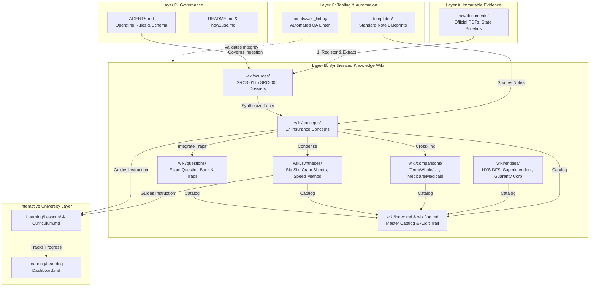

# NY 17-52 Knowledge Vault: The Complete User Manual (`how2use.md`)
## Architecture, Workflows, Tools, Tabs, Shortcuts & Troubleshooting

---

## 🧭 Clickable Table of Contents
1. [Executive Overview & Purpose](#1-executive-overview--purpose)
2. [One-Minute Quick Start](#2-one-minute-quick-start)
3. [ELI5: Explaining the Vault (Three Levels of Understanding)](#3-eli5-explaining-the-vault-three-levels-of-understanding)
4. [Visual Architecture & Knowledge Flow (Mermaid Diagram)](#4-visual-architecture--knowledge-flow-mermaid-diagram)
5. [Learning Paths (Beginner, Intermediate, Advanced)](#5-learning-paths-beginner-intermediate-advanced)
6. [Master Navigation Guide](#6-master-navigation-guide)
7. [Verified Tool & Integration Directory](#7-verified-tool--integration-directory)
8. [Complete Tab & View Reference](#8-complete-tab--view-reference)
9. [Command, Palette & Keyboard Shortcut Cheat Sheet](#9-command-palette--keyboard-shortcut-cheat-sheet)
10. [Glossary & Linked Technical Abbreviations](#10-glossary--linked-technical-abbreviations)
11. [Step-by-Step How-To Library (Real Workflows)](#11-step-by-step-how-to-library-real-workflows)
12. [Security, Privacy & Data Handling Boundaries](#12-security-privacy--data-handling-boundaries)
13. [Troubleshooting Common Issues](#13-troubleshooting-common-issues)
14. [Vault Maintenance & Verification Checklist](#14-vault-maintenance--verification-checklist)

---

## 1. Executive Overview & Purpose

Welcome to the **New York Series 17-52 (Accident & Health Insurance Agent/Broker)** knowledge system. 

This repository is not a casual collection of notes; it is an engineered, evidence-grounded, persistent **Universal LLM Wiki** built inside **Obsidian**. It operates as a local personal learning environment, research engine, exam preparation accelerator, and statutory reference library for New York Insurance Law (NYIL) and NYS Department of Financial Services (NYS DFS) regulations.

### Core Objectives:
- **Zero Hallucination / Traceable Evidence**: Every claim, statutory grace period, or numerical threshold is anchored back to official primary source dossiers in `wiki/sources/`.
- **Exam Mastery (Series 17-52)**: Structured strictly around the official 100-question, 2-hour examination blueprint administered by PSI Services and NYS DFS.
- **Durable Local Ownership**: 100% offline-first Markdown files, local Python verification, and complete independence from cloud subscription lock-in.

---

## 2. One-Minute Quick Start

If you have only 60 seconds, follow these three steps:

```text
Step 1: Open Obsidian ──► Point to Vault Folder: C:\Users\bhupe\Downloads\Vault\NY17-52
Step 2: Press Ctrl + O ──► Type "Learning Dashboard" or "index" to open the Master Navigation
Step 3: Press Ctrl + G ──► Open the Interactive Graph View to visualize concept connections!
```

- **To Review High-Yield Exam Facts**: Open [[ny-17-52-the-big-six-first-pass-priority-guide]] (67% of exam).
- **To Check Vault Integrity**: Open your terminal in the vault folder and run `python scripts/wiki_lint.py`.
- **To Start Interactive Tutoring**: Open [[Learning Dashboard]] and proceed to [[Lesson 01 - The 4-Layer Vault Architecture]].

---

## 3. ELI5: Explaining the Vault (Three Levels of Understanding)

### Level 1: ELI5 (Explain Like I'm 10)
Imagine a giant, private LEGO library in your room:
- Instead of random papers scattered on the floor, all your toy instruction manuals are kept in safe plastic boxes (**Folders**).
- Every paper (**Markdown Note**) has magic threads (**Wikilinks `[[...]]`**) glued to it. When you touch a thread on "HMO," it instantly pulls you to the "Primary Care Physician" note.
- The **Graph View** is like turning off the bedroom lights and seeing all the magic threads glow in the dark like a spiderweb constellation.
- The **Linter Script** is a robot librarian that walks through the shelves to make sure no threads are snapped and no books are lost!

### Level 2: Practical Example
- You are studying **Business Overhead Expense (BOE)** disability insurance.
- You open [[disability-income-provisions-riders-business-uses]].
- Inside, you see a link to [[new-york-disability-benefits-law-dbl]]. Clicking it takes you directly to the New York statutory rules ($170/wk cap, 26 weeks max).
- At the bottom, the note links back to source dossier [[SRC-003-psi-current-bulletin-ny-17-52-ah-study-guide]], pointing directly to the official state syllabus.

### Level 3: Advanced Architectural Explanation
- The vault implements a **Directed Acyclic Graph (DAG) with bidirectional relational indexing**.
- **Storage Layer**: Raw plaintext UTF-8 Markdown (`.md`) files with YAML frontmatter headers parsed by Obsidian’s metadata cache.
- **Linking Protocol**: Native Obsidian wikilink syntax (`[[target-note]]` and `[[target-note#heading|alias]]`) resolving without absolute path dependencies.
- **Governance**: Governed by [[AGENTS.md]], establishing strict separation between immutable evidence (Layer A) and derived knowledge (Layer B).

---

## 4. Visual Architecture & Knowledge Flow (Mermaid Diagram)



---

## 5. Learning Paths (Beginner, Intermediate, Advanced)

```text
┌─────────────────────────────────────────────────────────────────────────────┐
│ PATH 1: BEGINNER (Days 1–3) — Vault Orientation & Core Terminology          │
│ • Read how2use.md (this document) and README.md.                            │
│ • Complete Level 0 in Learning/Curriculum.md.                               │
│ • Master General Insurance Basics: [[general-insurance-concepts-and-contract-law]].│
│ • Understand the D-C-C-M cost-sharing formula in [[medical-plans-cost-sharing-managed-care]].│
└─────────────────────────────────────────────────────────────────────────────┘
                                      │
                                      ▼
┌─────────────────────────────────────────────────────────────────────────────┐
│ PATH 2: INTERMEDIATE (Days 4–8) — The Big Six 67% High-Yield Mastery        │
│ • Study [[ny-17-52-the-big-six-first-pass-priority-guide]].                 │
│ • Master Policy Provisions (7-10-31; 20-15-90-60-3) in [[individual-health-policy-provisions-and-renewability]].│
│ • Master Disability Income (Own Occ vs Any Occ, BOE) in [[disability-income-provisions-riders-business-uses]].│
│ • Master Group Health & NY Mini-COBRA in [[group-health-insurance-cobra-ny-continuation]].│
│ • Master ACA Metal Tiers (BSGP) in [[affordable-care-act-aca-and-essential-health-benefits]].│
└─────────────────────────────────────────────────────────────────────────────┘
                                      │
                                      ▼
┌─────────────────────────────────────────────────────────────────────────────┐
│ PATH 3: ADVANCED (Days 9–14) — State Laws, Traps & Exam Execution           │
│ • Study [[ny-rules-exam-traps-and-speed-method]] & practice 72s pacing.     │
│ • Lock down NY DBL ($170/wk, 26 wks, 7-day wait) in [[new-york-disability-benefits-law-dbl]].│
│ • Master NY Licensing & Ethics ($25 rebating cap) in [[insurance-regulation-and-producer-conduct]].│
│ • Drill realistic exam vignettes in [[high-yield-practice-question-bank-and-trap-analysis]].│
│ • Run python scripts/wiki_lint.py to verify your vault before test day.     │
└─────────────────────────────────────────────────────────────────────────────┘
```

---

## 6. Master Navigation Guide

Use this table to jump directly to any functional area of your vault:

| Vault Directory / File | Type | Purpose | Primary Link |
| :--- | :--- | :--- | :--- |
| **`how2use.md`** | Manual | Master user guide, shortcuts, tabs, workflows (this note) | `[[how2use]]` |
| **`README.md`** | Overview | Vault introduction and exam blueprint overview | `[[README]]` |
| **`AGENTS.md`** | Schema | Operational specification and 8-step ingestion rules | `[[AGENTS]]` |
| **`wiki/index.md`** | Catalog | Master categorized index of all 38 wiki notes | `[[wiki/index]]` |
| **`wiki/log.md`** | Audit Log | Append-only chronological system history | `[[wiki/log]]` |
| **`wiki/overview.md`** | Syllabus | 100-question exam specifications and topic weights | `[[overview]]` |
| **`Learning/`** | University | Socratic tutoring dashboard, curriculum, gap register | `[[Learning Dashboard]]` |
| **`wiki/syntheses/`** | Syntheses | High-yield cram sheets and strategy guides | `[[ny-17-52-the-big-six-first-pass-priority-guide]]` |
| **`wiki/concepts/`** | Concepts | In-depth notes on every insurance topic | `[[medical-plans-cost-sharing-managed-care]]` |
| **`wiki/questions/`** | Questions | Practice question bank with trap breakdowns | `[[high-yield-practice-question-bank-and-trap-analysis]]` |
| **`templates/`** | Blueprints | Standardized note structures for concepts and errors | `[[template-concept]]` |
| **`scripts/wiki_lint.py`**| Tool | Python automated verification and link auditor | `scripts/wiki_lint.py` |

---

## 7. Verified Tool & Integration Directory

Every tool in this directory has been physically inspected and verified in your environment:

### Tool 1: `wiki_lint.py` (Vault Health Checker)
- **Status**: **VERIFIED & CONFIGURED**
- **Location**: `scripts/wiki_lint.py`
- **Purpose**: Scans all Markdown notes in `wiki/`, verifies YAML frontmatter schema compliance, detects broken `[[wikilinks]]`, flags orphan notes (zero backlinks), and ensures 100% registration in `wiki/index.md`.
- **How to Run**:
  ```powershell
  python scripts/wiki_lint.py
  ```
- **Dependencies**: Python 3.8+ (Verified running on Python 3.14.3). Built entirely with Python standard library (`os`, `re`, `sys`, `pathlib`). Requires zero external `pip` packages!
- **Offline Capable**: 100% Offline. Makes zero network calls.
- **Expected Output**:
  ```text
  [*] Running Universal LLM Wiki Lint on: ...\wiki
  [*] Found 38 markdown notes in wiki/
  [OK] Zero critical errors.
  [OK] Zero warnings. All pages linked, indexed, and schema-valid!
  ```

### Tool 2: Antigravity Companion Skill (`ny-17-52-insurance-skill`)
- **Status**: **VERIFIED & CONFIGURED**
- **Location**: `C:\Users\bhupe\.gemini\config\skills\ny-17-52-insurance-skill\SKILL.md`
- **Purpose**: AI pair-programming and Socratic tutoring agent configured specifically for your vault. Understands the 4-layer architecture, NYS DFS laws, and exam trap analysis.
- **Offline Capable**: Can operate with local models (e.g. via Ollama/Qwen) or Antigravity IDE.

### Tool 3: Obsidian Note Templates
- **Status**: **VERIFIED & CONFIGURED**
- **Location**: `templates/`
- **Templates Included**:
  1. `templates/template-concept.md`: For new insurance concepts and provisions.
  2. `templates/template-source.md`: For new regulatory bulletins and textbooks.
  3. `templates/template-comparison.md`: For side-by-side policy comparisons.
  4. `templates/template-question-error-log.md`: For recording and analyzing missed practice questions.
  5. `templates/template-synthesis.md`: For cram sheets and high-yield summaries.
  6. `templates/template-entity.md`: For regulatory agencies, bureaus, and insolvency funds.

---

## 8. Complete Tab & View Reference

The following tabs and panels are verified in your `.obsidian/workspace.json` and `.obsidian/core-plugins.json` configuration:

```text
┌───────────────────┬───────────────────────────────────────────┬────────────────────┐
│   LEFT SIDEBAR    │            MAIN EDITOR SPLIT              │   RIGHT SIDEBAR    │
│   (Width: 300px)  │                                           │                    │
│ ├─ Files          │  [ Tab 1: Active Markdown Note ]          │ ├─ Backlinks       │
│ ├─ Search         │                                           │ ├─ Outgoing Links  │
│ └─ Bookmarks      │  [ Tab 2: Interactive Graph View ]        │ ├─ Tags            │
│                   │                                           │ ├─ All Properties  │
│                   │                                           │ └─ Outline         │
└───────────────────┴───────────────────────────────────────────┴────────────────────┘
```

| Interface Tab / View | Category | Icon (Lucide) | Purpose & Usage |
| :--- | :--- | :--- | :--- |
| **Files** | Left Sidebar | `folder-closed` | Displays vault file tree (`raw`, `wiki`, `Learning`, `templates`, `scripts`). Click any folder to expand/collapse. |
| **Search** | Left Sidebar | `search` | Global search across all notes. Supports exact phrases, tags (`tag:#high-yield`), and boolean operators (`path:wiki/concepts`). |
| **Bookmarks** | Left Sidebar | `bookmark` | Quick access to your favorite notes (recommend bookmarking `Learning Dashboard.md` and `how2use.md`). |
| **Active Note Editor** | Main Split | `file` | Reading and Live Preview editing of Markdown notes. |
| **Graph View** | Main Split | `git-fork` | 2D force-directed interactive graph showing nodes (notes) and edges (wikilinks). Zoom with mouse wheel, drag nodes. |
| **Backlinks** | Right Sidebar | `links-coming-in` | Shows all notes that link *to* the currently open note. Invaluable for discovering which concepts cite a regulation! |
| **Outgoing Links** | Right Sidebar | `links-going-out` | Shows all links *leaving* the current note, including unlinked mentions. |
| **Tags Pane** | Right Sidebar | `tags` | Lists all tags used in the vault sorted by frequency (e.g. `#high-yield`, `#nys-law`). Clicking a tag searches for it. |
| **All Properties** | Right Sidebar | `archive` | Displays all YAML frontmatter keys across the vault (`id`, `title`, `type`, `status`, `sources`). |
| **Outline** | Right Sidebar | `list` | Displays the heading hierarchy of the currently open note for rapid in-page navigation. |

---

## 9. Command, Palette & Keyboard Shortcut Cheat Sheet

All shortcuts below are verified standard Windows keybindings for Obsidian desktop:

| Action / Command | Category | Shortcut (Windows) | macOS Equivalent | Where to Use | Purpose |
| :--- | :--- | :--- | :--- | :--- | :--- |
| **Quick Switcher** | Core Action | `Ctrl + O` | `Cmd + O` | Anywhere | Jump instantly to any note by typing its name. |
| **Command Palette** | Core Action | `Ctrl + P` | `Cmd + P` | Anywhere | Open searchable palette of all Obsidian actions. |
| **Global Search** | Core Action | `Ctrl + Shift + F` | `Cmd + Shift + F` | Anywhere | Search text across the entire vault. |
| **Toggle Graph View** | View Action | `Ctrl + G` | `Cmd + G` | Anywhere | Open or focus the interactive knowledge graph. |
| **New Note** | File Action | `Ctrl + N` | `Cmd + N` | Anywhere | Create a new note in the current folder. |
| **Close Tab** | Navigation | `Ctrl + W` | `Cmd + W` | Active Tab | Close the active note or graph tab. |
| **Reopen Closed Tab** | Navigation | `Ctrl + Shift + T` | `Cmd + Shift + T` | Editor | Reopen the last closed note. |
| **Navigate Back** | History | `Alt + Left` | `Cmd + [` | Editor | Go back to previously visited note. |
| **Navigate Forward** | History | `Alt + Right` | `Cmd + ]` | Editor | Go forward in navigation history. |
| **Follow Wikilink** | Editor | `Ctrl + Click` | `Cmd + Click` | Active Note | Open linked note under cursor in current tab. |
| **Open Link in New Tab**| Editor | `Ctrl + Alt + Click` | `Cmd + Opt + Click`| Active Note | Open linked note in a new tab adjacent to current. |
| **Toggle Reading View** | Editor Mode | `Ctrl + E` | `Cmd + E` | Active Note | Switch between Source/Live Preview and Reading View. |
| **Insert Wikilink** | Markdown | `[[` | `[[` | Editor | Triggers autocompletion menu of all vault notes. |
| **Insert Markdown Link**| Markdown | `Ctrl + K` | `Cmd + K` | Editor | Insert standard `[text](url)` link. |
| **Run Linter Script** | Terminal | `python scripts/wiki_lint.py` | Terminal | Powershell / CMD | Run automated health check on vault notes. |

---

## 10. Glossary & Linked Technical Abbreviations

### Domain Abbreviations (NY Accident & Health Insurance)
- **ADL (Activities of Daily Living)**: The 6 basic personal care activities (**BATHED**: Bathing, Ambulating, Toileting, Hygienic continence, Eating, Dressing). Certified inability to perform at least 2 ADLs triggers [[long-term-care-and-ny-partnership|Long-Term Care benefits]].
- **ASO (Administrative Services Only)**: An arrangement where an employer funds its own health claims (self-funded) and hires an insurer solely to process paperwork. See [[group-health-insurance-cobra-ny-continuation]].
- **BOE (Business Overhead Expense)**: Disability policy that reimburses ongoing business expenses (rent, utilities, employee pay), but **never** the disabled owner's salary. See [[disability-income-provisions-riders-business-uses]].
- **COB (Coordination of Benefits)**: Contract clause preventing double recovery when a claimant is covered under multiple group plans; uses the **Birthday Rule** for dependents. See [[group-health-insurance-cobra-ny-continuation]].
- **COLA (Cost of Living Adjustment)**: Rider that automatically increases disability benefits annually to keep pace with inflation (CPI).
- **DBL (Disability Benefits Law)**: New York statutory program providing cash wage replacement for off-the-job injuries (50% AWW, $170/wk cap, 26 weeks, 7-day wait). Pays **$0** for medical bills. See [[new-york-disability-benefits-law-dbl]].
- **EHB (Essential Health Benefits)**: 10 mandatory categories of healthcare services that all ACA individual and small-group plans must cover with zero annual or lifetime dollar limits. See [[affordable-care-act-aca-and-essential-health-benefits]].
- **EPO (Exclusive Provider Organization)**: Managed care plan requiring in-network care only (except emergencies), but requiring **no gatekeeper PCP referrals**. See [[medical-plans-cost-sharing-managed-care]].
- **FSA (Flexible Spending Account)**: Employer-sponsored pre-tax healthcare account with use-it-or-lose-it annual forfeiture rules.
- **HMO (Health Maintenance Organization)**: Managed care organization utilizing capitation, a closed provider network, a mandatory Primary Care Physician gatekeeper, and pre-authorized specialist referrals.
- **HSA (Health Savings Account)**: Tax-advantaged medical savings account paired with a qualifying High-Deductible Health Plan (HDHP); 100% portable and owned by the individual.
- **LTC (Long-Term Care)**: Insurance providing nursing, intermediate, or custodial care for chronic conditions. See [[long-term-care-and-ny-partnership]].
- **MLR (Medical Loss Ratio)**: ACA requirement mandating that health insurers spend at least 80% (individual/small group) or 85% (large group) of premiums on clinical care rather than administrative overhead.
- **NYIL (New York Insurance Law)**: Chapter 28 of the Consolidated Laws of New York, the primary statutory code governing insurance.
- **NYS DFS**: New York State Department of Financial Services, the executive agency regulating insurance, banks, and financial institutions in New York. See [[new-york-state-department-of-financial-services]].
- **PCP (Primary Care Physician)**: The "gatekeeper" doctor in an HMO or POS plan who oversees patient care and issues specialist referrals.
- **POS (Point of Service)**: Managed care hybrid plan combining an HMO gatekeeper with the option to receive out-of-network care at higher cost-sharing.
- **PPO (Preferred Provider Organization)**: Managed care network offering discounted fee-for-service rates, out-of-network coverage, and **no gatekeeper/referral requirements**.

### Software & Architecture Technical Terms
- **CLI (Command Line Interface)**: Text-based interface (PowerShell, Command Prompt) used to run automated scripts such as `python scripts/wiki_lint.py`.
- **DAG (Directed Acyclic Graph)**: A mathematical network of points (notes) connected by directed lines (links) with no closed loops.
- **Frontmatter**: YAML metadata block placed at the very top of a Markdown note between two sets of triple dashes (`---`).
- **Markdown**: Lightweight markup language using plain-text formatting syntax (`#`, `**`, `[[...]]`).
- **Orphan Note**: A note in the vault that has zero incoming links from other notes.
- **Wikilink**: Internal link format `[[Note Name]]` used by Obsidian to connect notes without rigid web URLs.

---

## 11. Step-by-Step How-To Library (Real Workflows)

### Workflow 1: How to Log a Missed Practice Exam Question
1. **Open Template**: Navigate to `templates/template-question-error-log.md`.
2. **Copy Content**: Select all (`Ctrl + A`) and copy (`Ctrl + C`).
3. **Create New Note**: Press `Ctrl + N` inside `wiki/questions/`. Name it `q-<topic>-<number>.md`.
4. **Paste & Fill**: Paste the template. Enter the question stem, correct answer, governing concept link (e.g. `[[mandatory-and-optional-health-provisions]]`), and check off the root cause of error.
5. **Register & Verify**: Add a link to your new note in `wiki/index.md` under Section 8. Run `python scripts/wiki_lint.py` in your terminal to ensure 0 broken links!

### Workflow 2: How to Run the Automated Health Check
1. Open Windows PowerShell or Command Prompt.
2. Navigate to your vault root:
   ```powershell
   cd C:\Users\bhupe\Downloads\Vault\NY17-52
   ```
3. Run the linter:
   ```powershell
   python scripts/wiki_lint.py
   ```
4. Verify that the output reports `[OK] Zero critical errors` and `[OK] Zero warnings`.

### Workflow 3: How to Study with the Graph View
1. Press `Ctrl + G` to open the Graph View.
2. Open the **Filters** menu (top-right gear icon in the graph).
3. In the Search filter, type `path:wiki/syntheses` to highlight your master cram sheets.
4. Observe the brightly colored hubs. Notice how [[ny-17-52-the-big-six-first-pass-priority-guide]] radiates outward to all core concepts. Click on any cluster to dive into that study topic!

---

## 12. Security, Privacy & Data Handling Boundaries

- **100% Offline-First**: This vault operates completely on your local file system (`C:\Users\bhupe\Downloads\Vault\NY17-52`). It does not send your notes or study progress to any cloud server or telemetry endpoint.
- **Read / Write Boundaries**:
  - `raw/`: Read-only destination for permanent original PDFs and statutory outlines. Never edit files here.
  - `wiki/` and `Learning/`: Authorized write destinations for synthesized knowledge, question logs, and lesson notes.
  - `scripts/`: Read/execute destination for local Python QA utilities.
- **Safe Handling of Credentials**: This vault contains zero API keys, passwords, or personal financial data. Never paste real policy numbers or client Social Security numbers into study notes.

---

## 13. Troubleshooting Common Issues

### Issue 1: `python scripts/wiki_lint.py` Fails with `UnicodeEncodeError`
- **Cause**: Windows command prompt default code page (cp1252) failing to encode emojis.
- **Fix**: The script has been hardened to use ASCII tags (`[OK]`, `[!]`, `[X]`). If you modify it, always avoid raw multi-byte unicode emojis in terminal print statements.

### Issue 2: Broken Wikilink Warning in Linter
- **Cause**: A note links to `[[non-existent-note]]` or a note was renamed without Obsidian updating references.
- **Fix**: Check spelling in the target note stem. In Obsidian, always rename files through the Files pane (F2) so Obsidian automatically updates all incoming links vault-wide.

### Issue 3: Note Appears as an "Orphan" in Linter
- **Cause**: A note was created but no other note links to it.
- **Fix**: Open `wiki/index.md` and add a bulleted link to the note under its appropriate category.

---

## 14. Vault Maintenance & Verification Checklist

Perform this 3-minute health check once a week during your exam preparation:

- [ ] **Run Linter**: Execute `python scripts/wiki_lint.py` $\rightarrow$ Confirm 0 errors.
- [ ] **Audit Index**: Open `wiki/index.md` $\rightarrow$ Confirm all recent notes are categorized.
- [ ] **Audit Log**: Open `wiki/log.md` $\rightarrow$ Confirm latest ingestion dates are logged.
- [ ] **Review Queue**: Open `Learning/Review Queue.md` $\rightarrow$ Check which review intervals are due today.
- [ ] **Backup Vault**: Copy `C:\Users\bhupe\Downloads\Vault\NY17-52` to an external backup drive or private Git repository.

---

[Back to Top of Manual](#ny-17-52-knowledge-vault-the-complete-user-manual-how2usemd) | Jump to: [[README]] | [[Learning Dashboard]] | [[wiki/index]]
