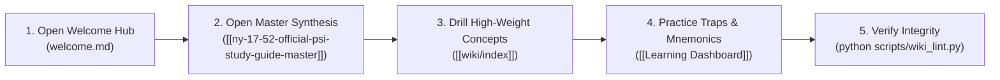
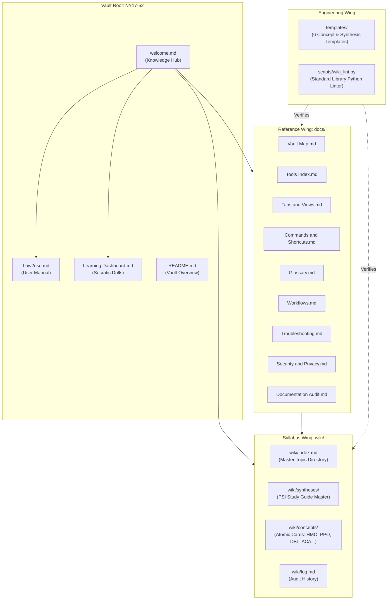

# Welcome to Your NY Series 17-52 Knowledge Hub

> **The definitive starting point for mastering the New York Accident & Health Insurance Agent/Broker (Series 17-52) licensing exam and navigating this interconnected Obsidian knowledge vault.**

---

## 1. What Is This Vault? (The ELI5 Analogy)

**In one sentence:** This vault is an offline, interconnected digital brain engineered to help you master every concept on the official New York Series 17-52 Accident & Health Insurance licensing exam.

### The Personal Library Analogy
Think of this vault as a **private, high-tech library**:
- **The Shelves (Folders):** Organize your knowledge into distinct wings—core study syntheses, atomic concept cards, reusable templates, and Python verification tools.
- **The Index Cards (Notes):** Each note explains exactly one concept in plain English with exam rules, mnemonics, and real-life scenarios.
- **The Invisible Strings (Wikilinks `[[ ]]`):** Every card connects directly to related cards. Clicking a link lets you walk seamlessly from an overarching law (like *ACA Essential Health Benefits*) straight to the specific policy provision (*Grace Period* or *Incontestability*).
- **The Automated Librarian (`scripts/wiki_lint.py`):** A lightweight background script checks your shelves every time you study, ensuring zero missing cards, zero broken links, and zero outdated references.

---

## 2. What This Vault Helps You Accomplish

1. **Pass the NY Series 17-52 Exam on Your First Attempt:** Focus 67% of your study time on the highest-weighted domains (Medical Plans, Basics, Provisions, Disability Income, ACA, Group) using the 80/20 rule.
2. **Eliminate Memorization Fatigue:** Learn through ELI5 analogies, memorable mnemonics (like *GRACE-7-10-31* and *INCON-2-YEARS*), and realistic scenario drills.
3. **Avoid Tricky Exam Traps:** Recognize misleading distractor answers involving absolute keywords (*"always"*, *"never"*), statutory deadlines (*10-day Free Look* vs. *30-day Senior Free Look*), and state vs. federal law jurisdictions.
4. **Maintain an Audit-Proof Knowledge System:** Keep all notes connected, structured with valid YAML frontmatter, and 100% offline and secure.

---

## 3. Quick-Start Guide for First-Time Users

If you only have **5 minutes right now**, follow this 3-step action path:
1. **Press `Ctrl + O`**: Type `ny-17-52-official-psi-study-guide-master` and press Enter. This is your master syllabus breakdown.
2. **Press `Ctrl + G`**: Open the interactive **Graph View** to visually see how all medical plans, state mandates, and policy provisions connect.
3. **Open the Dashboard**: Press `Ctrl + O` and type `Learning Dashboard` to run practice scenario questions and review high-yield mnemonics.

---

## 4. The 5 Most Useful Actions to Learn First

| Action | Shortcut / Command | What It Does | Why You Need It |
| :--- | :--- | :--- | :--- |
| **1. Quick Switcher** | `Ctrl + O` | Instantly jump to any note by typing its name. | Fastest way to navigate the vault without touching the mouse. |
| **2. Interactive Graph** | `Ctrl + G` | Opens the 3D visual network graph of all connected notes. | Lets you spot knowledge clusters and orphan topics immediately. |
| **3. Command Palette** | `Ctrl + P` | Opens Obsidian's central command terminal. | Gives you instant access to any Obsidian feature or setting. |
| **4. Integrity Linter** | `python scripts/wiki_lint.py` | Runs the zero-dependency Python link auditor in your terminal. | Confirms all internal wikilinks, metadata, and index entries are 100% valid. |
| **5. AI Exam Tutor** | Prompt Local Agent | Activate the `ny-17-52-insurance-skill` in Antigravity. | Conducts Socratic drills and explains tricky questions in real time. |

---

## 5. Linked Table of Contents

- [1. What Is This Vault? (The ELI5 Analogy)](#1-what-is-this-vault-the-eli5-analogy)
- [2. What This Vault Helps You Accomplish](#2-what-this-vault-helps-you-accomplish)
- [3. Quick-Start Guide for First-Time Users](#3-quick-start-guide-for-first-time-users)
- [4. The 5 Most Useful Actions to Learn First](#4-the-5-most-useful-actions-to-learn-first)
- [5. Linked Table of Contents](#5-linked-table-of-contents)
- [6. Visual Architecture Map](#6-visual-architecture-map)
- [7. Answers to the 10 Core Questions](#7-answers-to-the-10-core-questions)
- [8. Essential vs. Advanced Features](#8-essential-vs-advanced-features)
- [9. Deep Dive: Core Concepts in 3 Levels (ELI5 -> Intermediate -> Advanced)](#9-deep-dive-core-concepts-in-3-levels-eli5---intermediate---advanced)
- [10. Complete Documentation & Reference Library](#10-complete-documentation--reference-library)

---

## 6. Visual Architecture Map

The diagram below reflects the verified folder layout and data flow of your vault:

---

## 7. Answers to the 10 Core Questions

### Q1: Where do I start?
**Answer:** Right here on `[[welcome]]`. Review the Quick-Start above, then read the master synthesis at `[[ny-17-52-official-psi-study-guide-master]]`.

### Q2: What should I open first?
**Answer:** Open `[[Learning Dashboard]]` for active recall drills, or `[[wiki/index]]` to browse the 10 official exam domains.

### Q3: Where is everything stored?
**Answer:** 
- **Exam Knowledge:** In `wiki/` (`wiki/concepts/` and `wiki/syntheses/`).
- **User Manuals & Architecture:** In `docs/` and root (`welcome.md`, `how2use.md`).
- **Templates:** In `templates/`.
- **Quality Scripts:** In `scripts/wiki_lint.py`.
- For a complete visual breakdown, see `[[Vault Map]]`.

### Q4: How do I create a note?
**Answer:** 
1. Press `Ctrl + N` in Obsidian.
2. Open the Command Palette (`Ctrl + P`) and choose **Templates: Insert template**.
3. Pick `templates/template-concept.md` to instantly get standard YAML frontmatter and exam section headers.

### Q5: How do I find an existing note?
**Answer:** 
- Press `Ctrl + O` (Quick Switcher) to search by title or alias.
- Press `Ctrl + Shift + F` (Global Search) to search inside the full text of all notes.

### Q6: How do I connect two notes?
**Answer:** Type two open square brackets `[[`, type the name of the note (e.g., `[[health-maintenance-organization-hmo]]`), and press Enter.

### Q7: How do I use tools and plugins?
**Answer:** The vault utilizes Obsidian's built-in core plugins (Quick Switcher, Graph View, File Recovery) and a standalone Python verification script `scripts/wiki_lint.py`. Full instructions are documented in `[[Tools Index]]`.

### Q8: How do I run commands?
**Answer:** Press `Ctrl + P` to bring up the Obsidian Command Palette. From there, type any action (e.g., "Toggle fold all", "Insert template").

### Q9: How do I learn keyboard shortcuts?
**Answer:** Check `[[Commands and Shortcuts]]` for a complete categorized table of navigation, editing, and window-management hotkeys.

### Q10: How do I troubleshoot common problems?
**Answer:** If you encounter encoding warnings, broken links, or missing notes, open `[[Troubleshooting]]` or run `python scripts/wiki_lint.py` in your terminal.

---

## 8. Essential vs. Advanced Features

| Feature Tier | Capabilities | When to Use | Reference Guide |
| :--- | :--- | :--- | :--- |
| **Essential (Start Here)** | Quick Switcher (`Ctrl+O`), Note Reading, Wikilinks (`[[ ]]`), Markdown formatting, Backlinks pane. | Daily study, reading concepts, following exam syllabi. | `[[how2use]]` |
| **Intermediate** | Graph View (`Ctrl+G`), Templates (`templates/`), YAML tags, Global text search (`Ctrl+Shift+F`), Outline pane. | Creating notes, connecting related insurance clauses, organizing chapters. | `[[Tabs and Views]]` |
| **Advanced** | Automated integrity linting (`scripts/wiki_lint.py`), Socratic AI agent drills, Git version control, offline backup snapshots. | Weekly vault maintenance, simulated exam audits, conflict resolution. | `[[Workflows]]`, `[[Tools Index]]` |

---

## 9. Deep Dive: Core Concepts in 3 Levels (ELI5 -> Intermediate -> Advanced)

### 1. Vaults and Folders
- **ELI5:** A vault is one giant binder on your desk. Folders are the color-coded dividers inside that binder.
- **Intermediate Example:** In this vault, `wiki/concepts/` holds individual insurance cards, while `docs/` holds reference manuals.
- **Advanced Use:** Obsidian treats the vault root as an absolute file-system boundary. Standardizing folder structures allows deterministic Python AST scripts (`scripts/wiki_lint.py`) to validate link graphs without external database engines.

### 2. Notes and Markdown
- **ELI5:** Notes are simple text files. Markdown is a way to make words **bold**, *italic*, or organized into bullet lists using basic keyboard symbols.
- **Intermediate Example:** Writing `# Medical Plans` creates a primary header, while `- [ ] Review HMO copays` creates a clickable checklist.
- **Advanced Use:** Because Markdown is stored in plain UTF-8 `.md` files, your knowledge is completely future-proof, portable, and independent of proprietary vendor locks.

### 3. Wikilinks and Backlinks
- **ELI5:** A wikilink is a teleporter from one page to another. A backlink is a radar screen that tells you who is pointing at you.
- **Intermediate Example:** Typing `[[grace-period-and-reinstatement]]` inside `[[individual-accident-and-health-policy-provisions]]` creates a forward link. When you open the Grace Period note, its Right Sidebar displays the Provisions note under **Backlinks**.
- **Advanced Use:** Bidirectional links build an emergent network topology. They eliminate deep folder hierarchies and reveal conceptual intersections (e.g., how *New York DBL* intersects with *Coordination of Benefits*).

### 4. Tags, Aliases, and Properties
- **ELI5:** Properties are sticky labels on the front of a note (like author or date). Tags are hashtags to group similar cards. Aliases are nicknames so you can find a note by multiple names.
- **Intermediate Example:** The note `health-maintenance-organization-hmo.md` has the alias `HMO` and tag `#medical-plans`. Searching for "HMO" opens the exact note immediately.
- **Advanced Use:** Standardized YAML frontmatter (`---`) allows scripts and metadata engines to filter, query, and validate notes programmatically.

### 5. Templates
- **ELI5:** A cookie cutter that stamps out a pre-formatted note with all the right headings already filled in.
- **Intermediate Example:** Using `templates/template-concept.md` automatically inserts sections for *ELI5 Explanation*, *Exam Rules & Distinctions*, *Memorable Mnemonic*, and *Multiple Choice Trap*.
- **Advanced Use:** Ensures zero structural drift across hundreds of study cards, making programmatic parsing and AI extraction fully predictable.

### 6. Search and Graph View
- **ELI5:** Search is your magnifying glass to find any word. Graph View is a constellation map showing how your notes connect like stars.
- **Intermediate Example:** Pressing `Ctrl + G` visualizes the entire NY 17-52 curriculum. Dense clusters indicate major exam areas (like *Medical Plans* and *Provisions*).
- **Advanced Use:** Orphan nodes (notes with zero links) stand out immediately as isolated dots, flagging missing references or forgotten topics.

### 7. Local Automation & Python Linter
- **ELI5:** An automated robot assistant that scans every page in seconds to make sure no links are broken.
- **Intermediate Example:** Running `python scripts/wiki_lint.py` in your terminal prints an instant `[OK]` status for 38+ notes.
- **Advanced Use:** Employs regex-based slug matching and Windows CP1252-safe ASCII reporting to enforce relational integrity across wiki nodes and root documentation without any third-party dependencies.

### 8. Local AI Tutoring Companion
- **ELI5:** A personal 24/7 private tutor who quizzes you on tricky insurance questions and never gets tired.
- **Intermediate Example:** Prompting the agent with *"Drill me on New York Free Look rules"* triggers a scenario contrasting the standard 10-day rule with the 30-day senior Medicare Supplement requirement.
- **Advanced Use:** Grounded strictly in the PSI Series 17-52 Candidate Bulletin using local RAG memory to avoid hallucinations or Life-insurance bleed-through.

### 9. Version Control & Backups
- **ELI5:** A time machine. If you accidentally delete a chapter, you can rewind time and restore it.
- **Intermediate Example:** Obsidian's built-in **File Recovery** core plugin saves snapshots of your edits every 5 minutes.
- **Advanced Use:** Committing the vault to an offline Git repository provides immutable cryptographic tracking (`git log`) and branch experimentation for large revisions.

---

## 10. Complete Documentation & Reference Library

Every aspect of this vault is documented in dedicated reference files in `docs/` and root:

| Document | Primary Focus | Best For |
| :--- | :--- | :--- |
| **[[how2use]]** | Master Vault Manual | Step-by-step user manual covering every aspect of the vault. |
| **[[Vault Map]]** | Visual Architecture | Complete directory topology, folder roles, and data flow. |
| **[[Tools Index]]** | Tools & Integrations | Python linter, templates, and Antigravity AI companion. |
| **[[Tabs and Views]]** | UI Reference Guide | Explanation of all panels, sidebars, graph view, and editor tabs. |
| **[[Commands and Shortcuts]]** | Command Catalogue | Comprehensive hotkey cheat sheet and command palette directory. |
| **[[Glossary]]** | Technical & Insurance Terms | 40+ definitions covering both A&H domain concepts and Obsidian terms. |
| **[[Workflows]]** | Practical Procedures | Step-by-step guides for studying, creating notes, and auditing. |
| **[[Troubleshooting]]** | Diagnostic & Error Guide | How to resolve broken links, orphan notes, and encoding issues. |
| **[[Security and Privacy]]** | Privacy Boundaries | Verification of offline operation, permissions, and zero data leakage. |
| **[[Documentation Audit]]** | Quality & Coverage Matrix | Complete verification matrix mapping all vault features to proof. |
| **[[Learning Dashboard]]** | Exam Prep & Drills | Active recall curriculum, mnemonics, and tricky question scenarios. |
| **[[wiki/index]]** | Syllabus Concept Index | Master list of all atomic Accident & Health concept notes. |

---

*Last Reviewed: 2026-10-25 | Status: VERIFIED | Vault: NY17-52*
