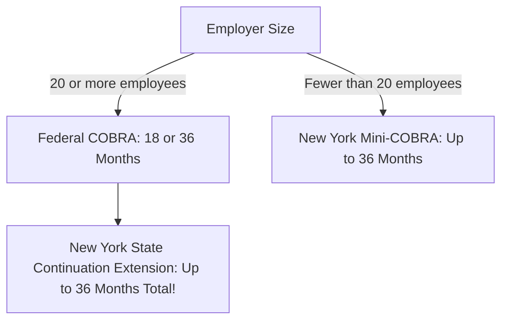

# Group Health Insurance, COB, COBRA & NY Continuation

## 1. Plain-English Concept (For a 10-Year-Old)
- **Group Insurance (The Big Team Discount)**: Instead of selling an insurance pass to one person, the insurance company sells one giant master contract to a company with 500 workers. Because it's a team, **nobody takes a medical exam** (guaranteed issue)! The boss gets the **Master Policy**, and each worker gets a little ID card called a **Certificate of Insurance**.
- **Blanket Insurance (The School Bus Policy)**: Like a sports team, camp, or passengers on a plane. The roster changes every week, so no individual certificates are given. You are covered automatically as long as you are sitting on the team bus!
- **Coordination of Benefits & The Birthday Rule**: If Mom and Dad both have family insurance on their kid, who pays first? The **Birthday Rule** says: Whichever parent has their birthday **earliest in the calendar year** (e.g. February 10 beats October 15, regardless of age) is the **Primary Plan** that pays first!
- **COBRA & New York Continuation (The Safety Net)**: If you get fired or laid off, you don't instantly lose your health plan. Under federal COBRA and New York law, you can keep your exact same group coverage, but you must pay **102% of the full premium** (your share + the boss's share + a 2% administrative fee).

---

## 2. Federal COBRA vs. New York State Continuation ("Mini-COBRA")

| Dimension | Federal COBRA | New York State Continuation Law ("Mini-COBRA") |
| :--- | :--- | :--- |
| **Employer Size Threshold** | **20 or more** employees | Applies to **ALL employer sizes (1 to 19 employees)**! |
| **Standard Qualifying Events (Termination / Reduction in hours)** | **18 Months** | **36 Months** in New York! (NY extends federal 18-month COBRA to **36 total months**). |
| **Other Qualifying Events (Divorce, Death of employee, Dependent aging out)** | **36 Months** | **36 Months** |
| **Gross Misconduct** | Terminated for gross misconduct = **NO COBRA** | Same (Disqualified) |
| **Maximum Premium Charged** | **102%** of full group premium | **102%** of full group premium |
| **Election Window** | **60 days** from notification date | **60 days** from notification date |

---

## 3. Group Conversion Privilege (NY Rule)
- When group health coverage terminates (or COBRA expires), the employee has a statutory right to convert to an individual policy **WITHOUT evidence of insurability** (no medical exam).
- Must apply and pay premium within **31 days** of group coverage termination.

---

## 4. Contributory vs. Noncontributory Plans
- **Noncontributory Plan**: Employer pays **100% of the premium**. Mandates **100% employee participation** (eliminates adverse selection).
- **Contributory Plan**: Employee pays part of the premium. Requires at least **75% employee participation**.

---

## 5. Exam Trap Question & Distractor Analysis

> **Scenario**: An employee at an 8-person design firm in Buffalo, NY is laid off. The employee asks to continue their group health insurance. The employer states: "We have fewer than 20 workers, so COBRA does not apply to us." What is the legal outcome under New York law?
> - A) The employer is correct; the employee has no continuation rights.
> - B) The employer is incorrect; New York State Continuation law gives the employee up to 36 months of continuation.
> - C) The employee can only continue coverage if they have an active disability.
> - D) The employee is eligible for federal COBRA for 18 months regardless of employer size.
>
> **Correct Answer**: **B) The employer is incorrect; New York State Continuation law gives the employee up to 36 months of continuation.**
> - **Rationale**: While Federal COBRA applies only to employers with 20+ workers, **New York State Mini-COBRA applies to small employers (under 20 workers)** and provides up to **36 months** of continued coverage!
> - **Tempting Wrong Answer**: **A** is tempting if you only know national federal COBRA rules. In NY, small group workers are protected under state continuation!

---

## 6. Cross-References
- Outline: [[SRC-002-nys-dfs-psi-series-17-52-accident-health-outline]]
- ACA Standards: [[affordable-care-act-aca-and-essential-health-benefits]]
- State Law: [[ny-specific-state-insurance-laws-mastery]]
