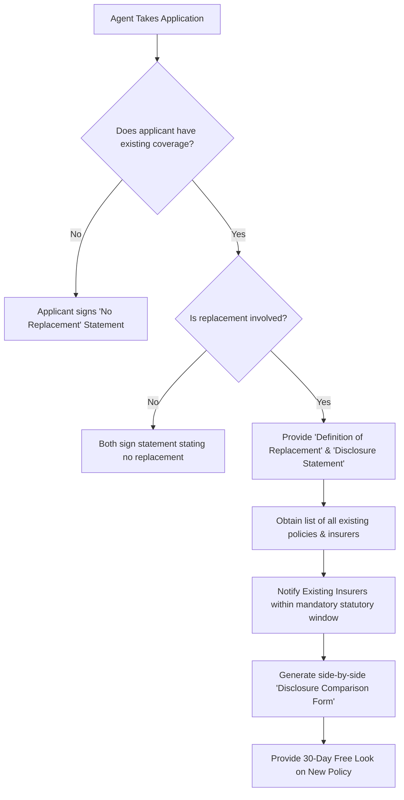

# New York Insurance Regulation 60: Replacement of Life Insurance and Annuities

## 1. Executive Summary
**11 NYCRR Part 51 (Insurance Regulation 60)** is New York's strict, consumer-protection regulation governing the **replacement** of existing life insurance policies or annuity contracts with new ones. Because replacement often disadvantages consumers through new surrender charges, higher premium costs due to advanced age, restart of contestable and suicide periods, and substantial agent commissions, New York enforces rigorous disclosure, comparison, and notification requirements before any transaction can close.

---

## 2. Legal Definition of Replacement in New York

Replacement occurs whenever a new life insurance policy or annuity is to be purchased, and as part of the transaction or proposed transaction, an existing policy or annuity has been or is to be:
1. **Lapsed, forfeited, surrendered**, or otherwise terminated.
2. **Converted to reduced paid-up insurance**, continued as extended term insurance, or otherwise reduced in value by the use of nonforfeiture benefits.
3. **Amended** so as to effect either a reduction in benefits or in the term for which coverage would otherwise remain in force.
4. **Reissued with any reduction in cash value**.
5. **Pledged as collateral or subjected to borrowing or policy loans** exceeding **25%** of the loan value.

---

## 3. Mandatory Agent Duties under Regulation 60

When an agent takes an application for life insurance or an annuity:

1. **Submit Statement with Application**:
   - The agent must submit to the insurer with or as part of each application a statement signed by both the applicant and the agent as to whether the transaction involves replacement of existing policies.
2. **If Replacement IS Involved**:
   - **Give Applicant Notice**: The agent must present and leave with the applicant a copy of the **"Important Notice Regarding Replacement or Change of Life Insurance Policies or Annuity Contracts"** (Appendix 10C / 10A).
   - **Obtain List of Existing Policies**: The agent must obtain a signed list of all existing policies/contracts to be replaced, including insurer names and contract numbers.
   - **Forward Information**: Promptly send the replacing insurer the list of policies and copies of all sales materials.
   - **Disclosure Statement**: A completed **Disclosure Statement** comparing the existing policy with the proposed policy side-by-side must be delivered to the applicant **prior to or at the time of accepting the initial premium or application**.

---

## 4. Mandatory Insurer Duties under Regulation 60

1. **Notice to Existing Insurer**:
   - Within **10 days** of receiving an application indicating replacement, the replacing insurer must notify the existing insurer and provide copies of the disclosure statement and comparison material.
2. **Delay Period**:
   - The replacing insurer must allow the existing insurer a reasonable period (typically **20 days** to provide policy information, and must maintain records for at least **6 years**).
3. **Special Replacement Free-Look Period**:
   - In New York, every policy issued as a replacement under Regulation 60 MUST provide a **30-Day Free Look (Right to Examine)** period (instead of the standard 10 days). During these 30 days, the applicant can return the policy for a **100% full refund** of all premiums paid.

---

## 5. Transactions Exempt from Regulation 60
The following transactions are exempt from Regulation 60 requirements:
- Group life insurance and group annuities (unless individual coverage is solicited to group members).
- Credit life insurance.
- Replacement of life insurance within the **same insurer** pursuant to a contractual conversion privilege (e.g. converting term to whole life within the same company).
- Policies used to fund prearranged funeral contracts.
- Non-convertible term policies expiring in **5 years or less** that cannot be renewed.

---

## 6. Exam Traps & Pitfalls (HIGH YIELD)

> [!WARNING]
> **Trap 1: The Free Look Period on Replacement**
> - Standard NY Life policy free look: **10 to 30 days** (usually 10).
> - **Replacement under Reg 60: 30 DAYS MANDATORY**.
>
> **Trap 2: Borrowing Trigger**
> - How much can be borrowed on an existing policy before it triggers Regulation 60?
> - Answer: Borrowing or pledging more than **25% of the loan value** constitutes a replacement!
>
> **Trap 3: "Twisting" vs. Legal Replacement**
> - Replacement is legal if all Regulation 60 disclosure forms, comparisons, and notices are strictly followed.
> - **Twisting** is an illegal, fraudulent replacement involving misleading comparisons or misrepresentations to induce an insured to drop an existing policy. Twisting is a misdemeanor and grounds for immediate license revocation under NYIL § 2123!

---

## 7. Cross-References
- Best Interest Regulation: [[new-york-insurance-regulation-187-suitability]]
- Core Provisions: [[standard-life-policy-provisions-and-riders]]
- NYS DFS Authority: [[new-york-state-department-of-financial-services]]
- Cram Sheet: [[ny-specific-state-insurance-laws-mastery]]
