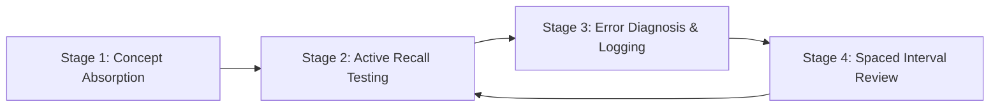

# Active Recall & Spaced Repetition Study Method for NY 17-52

## 1. Executive Summary
Passing the **NY Series 17-52 exam** with a high margin (85%+) requires shifting from passive reading (which creates an illusion of competence) to **Active Retrieval Practice** and **Spaced Repetition**. This method integrates the Obsidian wiki structure, question error logging, and mnemonic retrieval systems.

---

## 2. The 4-Stage Study System

### Stage 1: Structured Concept Ingestion
- Read the high-yield syntheses: [[ny-17-52-high-yield-exam-cram-sheet]] and [[ny-specific-state-insurance-laws-mastery]].
- Focus on the statutory numbers, grace periods, free looks, and penalty caps.

### Stage 2: Closed-Book Active Retrieval
- Close your notes and write out the core matrices from memory:
  - **The 12 Mandatory Health Provisions and their day limits** (7-10-31; 20-15-90-60-3).
  - **The 3 Nonforfeiture Options** (Cash Surrender, Reduced Paid-Up, Extended Term).
  - **The 5 Dividend Options** (CRAP-O).
  - **Regulation 60 replacement triggers and 30-day free look**.
  - **Guaranty Corporation limits** ($500k life / $100k cash value / $500k annuity).

### Stage 3: Error Diagnosis & Vault Logging
- When doing practice questions, never merely check the answer key.
- For every missed question or lucky guess, create an entry in [[high-yield-practice-question-bank-and-trap-analysis]] using `templates/template-question-error-log.md`.
- Categorize the root cause:
  1. *Did I misread "EXCEPT" or "NOT"?*
  2. *Did I confuse General rule with New York State specific statute?*
  3. *Did I forget a numerical timeframe?*

### Stage 4: Spaced Interval Review Schedule
- **Interval 1**: 24 hours after initial learning.
- **Interval 2**: 3 days later.
- **Interval 3**: 7 days later.
- **Interval 4**: 14 days later (final exam dress rehearsal).

---

## 3. High-Yield Mnemonic Index

| Mnemonic | Concept | Breakdown |
| :--- | :--- | :--- |
| **ACCL** | 4 Elements of Contract | **A**greement, **C**onsideration, **C**ompetent Parties, **L**egal Purpose |
| **CRAP-O** | 5 Life Dividend Options | **C**ash, **R**eduction of premium, **A**ccumulate at interest, **P**aid-up additions, **O**ne-year term |
| **CRE** | 3 Nonforfeiture Options | **C**ash surrender, **R**educed paid-up, **E**xtended term (default) |
| **20 - 15 - 90 - 60 - 3** | Health Claims Sequence | 20d notice $\rightarrow$ 15d claim forms $\rightarrow$ 90d proof of loss $\rightarrow$ 60d wait to sue $\rightarrow$ 3yr max to sue |
| **7 - 10 - 31** | Health Grace Periods | 7d weekly $\rightarrow$ 10d monthly $\rightarrow$ 31d quarterly/annual modes |

---

## 4. Cross-References
- Master Syllabus: [[overview]]
- Exam Cram Sheet: [[ny-17-52-high-yield-exam-cram-sheet]]
- Question Bank & Traps: [[high-yield-practice-question-bank-and-trap-analysis]]
