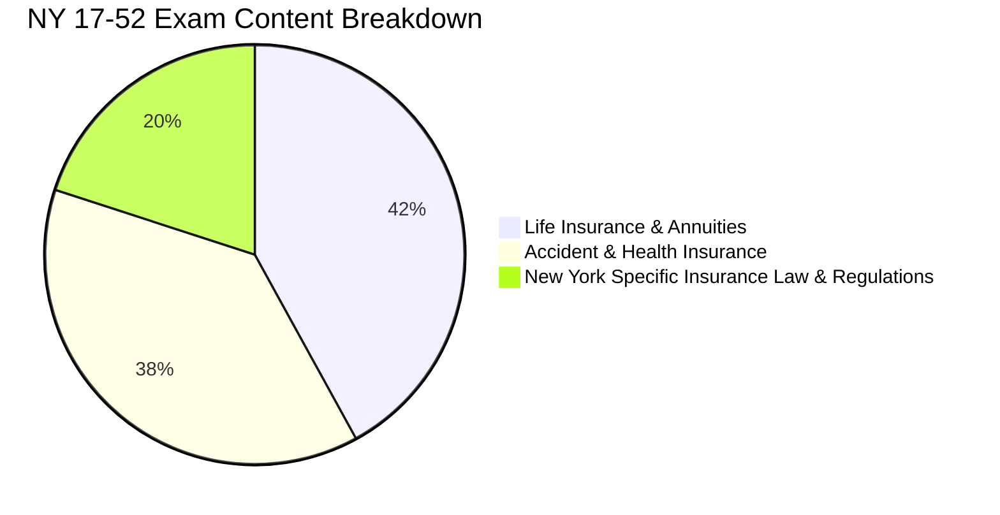

# NY 17-52 Examination Overview & Blueprint

## 1. Executive Summary
The **New York Series 17-52 (Life, Accident and Health Agent/Broker)** license examination qualifies individuals to market, solicit, negotiate, and sell Life Insurance, Annuities, and Accident & Health/Sickness insurance products within the State of New York under the regulatory jurisdiction of the **[[new-york-state-department-of-financial-services|NYS Department of Financial Services (DFS)]]**.

Passing this examination is mandatory to obtain either an **Agent License (Section 2103)** or a **Broker License (Section 2104)** under New York Insurance Law.

---

## 2. Examination Specifications

| Parameter | Specification |
| :--- | :--- |
| **Exam Code** | NY Series 17-52 |
| **Administering Provider** | PSI Services / Prometric on behalf of NYS DFS |
| **Total Test Questions** | 150 questions (typically 140 scored + 10 pre-test unscored experimental questions) |
| **Time Allowed** | 3.0 Hours (180 minutes) |
| **Passing Score** | **70%** (minimum 98 correct scored questions out of 140) |
| **Format** | Multiple Choice (4 answer choices: A, B, C, D), computer-based |
| **Prerequisites in NY** | Completion of 40 hours of approved pre-licensing education for Life, Accident & Health (or approved waiver/designation) |

---

## 3. Syllabus Blueprint & Weight Distribution

The exam is divided into three primary divisions:

### Division I: Life Insurance & Annuities (~40–45% of exam)
1. **General Contract Law & Underwriting**:
   - Elements of a legal contract: [[insurable-interest-and-contract-elements|Insurable Interest, Offer & Acceptance, Consideration, Competent Parties, Legal Purpose]].
   - Warranties vs. Representations, Concealment, Fraud, Estoppel and Waiver.
   - Underwriting factors: Medical information, MIB (Medical Information Bureau), Fair Credit Reporting Act (FCRA), USA PATRIOT Act/AML.
2. **Policy Types & Architecture**:
   - [[term-vs-whole-life-vs-universal-life|Term Life, Whole Life, Universal Life, Variable Life, Indexed Life]].
   - Specialized policies: Joint Life (First-to-Die), Survivorship Life (Second-to-Die), Juvenile Life.
3. **Provisions, Options, and Riders**:
   - [[standard-life-policy-provisions-and-riders|Mandatory provisions: Grace Period, Incontestability, Entire Contract, Suicide Clause]].
   - Nonforfeiture options: Cash Surrender, Reduced Paid-Up, Extended Term (Default).
   - Dividend options: CRAP-O (Cash, Reduction of Premium, Accumulate at Interest, Paid-up additions, One-year term).
   - Settlement options: Lump sum, Interest only, Fixed period, Fixed amount, Life income.
   - Policy riders: Waiver of premium, Guaranteed insurability, Accidental death benefit, Long-term care rider.
4. **Annuities & Qualified Plans**:
   - Accumulation vs. Annuitization phase, Immediate vs. Deferred, Fixed vs. Variable vs. Indexed.
   - Taxation of death benefits, cash value buildup, MECs (7-pay test), and annuity exclusion ratios.

### Division II: Accident & Health Insurance (~35–40% of exam)
1. **General Health Concepts & Plan Design**:
   - Fee-for-Service vs. Managed Care (HMO, PPO, POS, EPO).
   - Cost containment: Deductibles, Co-insurance, Stop-loss limits, Copayments.
   - Health Savings Accounts (HSA), Flexible Spending Accounts (FSA), HRA.
2. **Disability Income Insurance**:
   - Definition of Total Disability: "Own Occupation" vs. "Any Occupation".
   - Elimination (waiting) period, Benefit period, Presumptive disability.
   - Business uses: Business Overhead Expense (BOE), Key Person Disability, Disability Buy-Out.
3. **Senior Health & Long-Term Care**:
   - [[medicare-vs-medicaid-vs-medigap|Medicare (Parts A, B, C, D), MediGap (Standardized Plans A–N)]].
   - Medicaid (Title XIX): Income and asset limits, nursing home coverage.
   - Long-Term Care Insurance (LTC): Activities of Daily Living (ADLs: bathing, dressing, eating, transferring, toileting, continence), Cognitive impairment.
   - **New York State Partnership for Long-Term Care**: Asset protection Medicaid rules.
4. **Health Policy Provisions**:
   - [[mandatory-and-optional-health-provisions|12 Mandatory Provisions & 11 Optional Provisions (Uniform Individual Accident and Sickness Policy Provisions Law)]].

### Division III: New York State Specific Laws & Regulations (~20% of exam - CRITICAL PASS/FAIL SWING)
- **[[superintendent-of-financial-services|Powers of the Superintendent]]**: Subpoena power, examination of records (at least once every 5 years for domestic insurers), cease and desist orders, fines up to $500 per violation ($2,500 aggregate for non-willful).
- **Licensing Rules**: Resident Agent (Section 2103) vs. Broker (Section 2104); Continuing Education (15 credits every 2-year renewal period, including at least 3 credits in ethics); 30-day notice for change of address or administrative actions.
- **Unfair Trade & Marketing Practices**: Rebating (strictly prohibited; gifts allowed up to $25 in NY), Twisting (misrepresentation to induce surrender/replacement), Defamation, False advertising.
- **[[new-york-insurance-regulation-60-replacement|Regulation 60 (Replacement)]]**: Stringent disclosure and comparison procedures, 60-day replacement notice, 30-day free look period on replacements.
- **[[new-york-insurance-regulation-187-suitability|Regulation 187 (Suitability and Best Interest)]]**: Standard of care requiring agents to act solely in the client's best interest without regard to financial incentives.
- **[[life-and-health-insurance-company-guaranty-corporation-of-new-york|Guaranty Corporation]]**: Protection limits ($500k life death benefit, $100k cash surrender, $500k annuity, $500k health).

---

## 4. Master Navigation & Study Roadmap
1. Start with high-yield syntheses: [[ny-17-52-high-yield-exam-cram-sheet]] and [[ny-specific-state-insurance-laws-mastery]].
2. Review core comparisons: [[term-vs-whole-life-vs-universal-life]] and [[medicare-vs-medicaid-vs-medigap]].
3. Drill question patterns and traps: [[high-yield-practice-question-bank-and-trap-analysis]].
4. Track errors and verify understanding with [[active-recall-and-spaced-repetition-study-method]].
